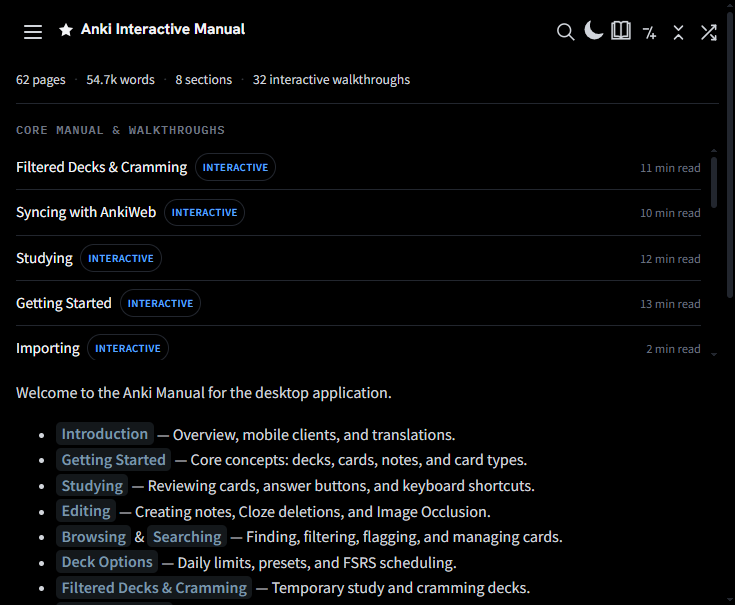
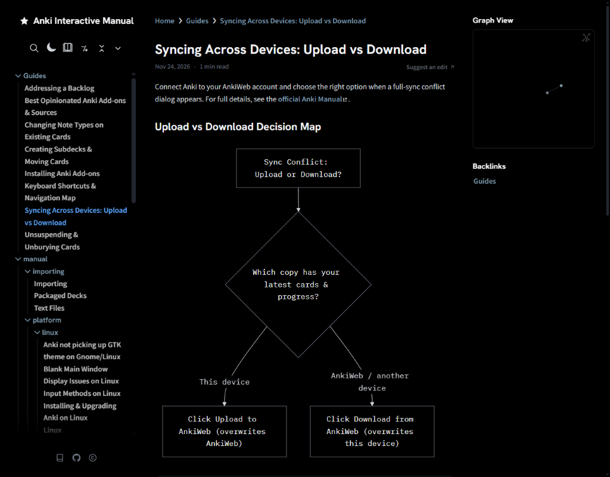

# Anki Interactive Manual

  

  
  
  
  
  
  
  

Hello! I'm a big fan of Anki and built this fan project to learn how to use GitHub, manage repositories, collaborate with others, and work with Quartz and a few other tools (listed below) for my own personal website and projects. I've tried to keep the content as faithful as possible to the official Anki Manual while adding a few extra features.

## Screenshots

## Tools & Stack Used

- [Official Anki Manual](https://docs.ankiweb.net/): The upstream documentation source adapted under CC BY-SA 4.0.
- [Quartz](https://quartz.jzhao.xyz/): Static site generator used to build and publish the documentation website.
- [GitHub Pages](https://pages.github.com/): Free static hosting and automated deployment via GitHub Actions.
- [Mimik](https://github.com/Westpoint/mimik): Desktop guide recorder used to capture step-by-step Anki walkthroughs.
- [Google Antigravity](https://antigravity.google/): AI development environment used to assist with coding and screenshot automation scripts.
- [diff2html](https://diff2html.xyz/): Generates visual comparisons between adapted pages and the latest upstream manual commit.
- [Giscus](https://giscus.app/): Comments system powered by GitHub Discussions.

The entire site is built with Quartz and hosted on GitHub Pages. Since I'm a medical student still learning coding, web development, and blogging, I've included clear disclaimers on the website. This project was built with significant help from AI (using Google Antigravity) by capturing Mimik tutorials and writing scripts to automate screenshot generation. All external links to the official documentation are preserved, and there is a button in the sidebar you can click to compare any page with the latest manual commit.

To gain hands-on experience with open-source collaboration, I added a "Suggest an Edit" button so even total beginners can contribute, and enabled Giscus so I can learn how GitHub discussions work. If you find this repository useful, please consider giving it a star! All credit for the original manual goes to the Anki creator and team—I don't own any part of their original work. The adapted manual remains under CC BY-SA 4.0, and my custom code is licensed under MIT.

https://github.com/user-attachments/assets/d40c3953-4a36-4666-9787-0bb49bb9f1cf
