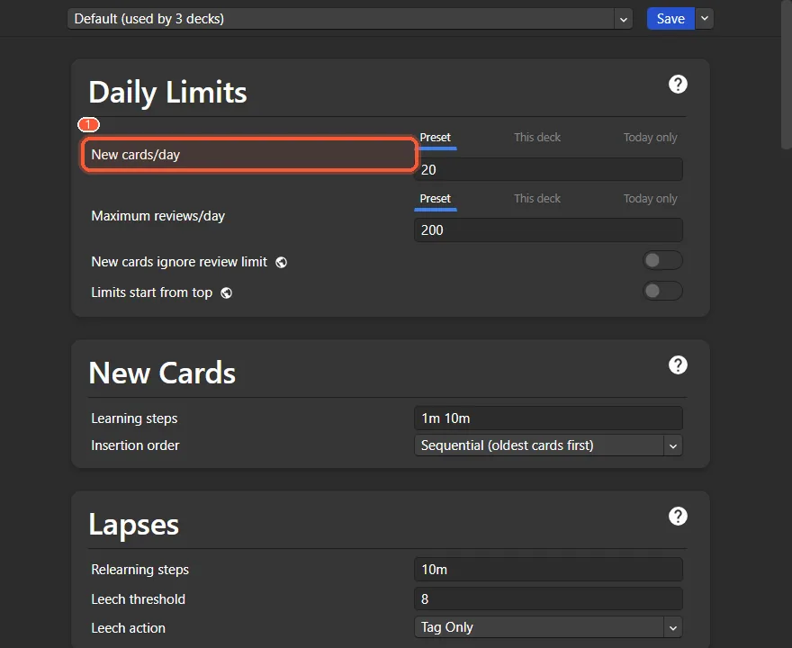
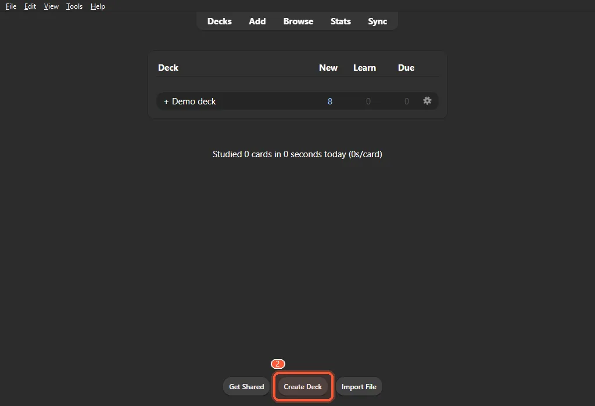
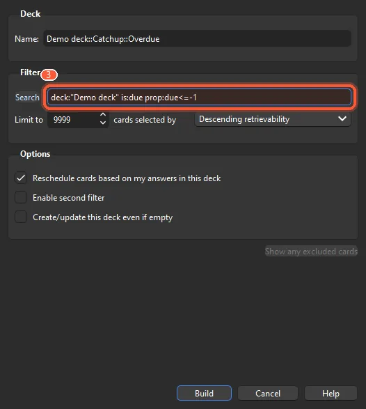
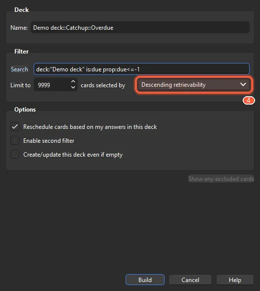
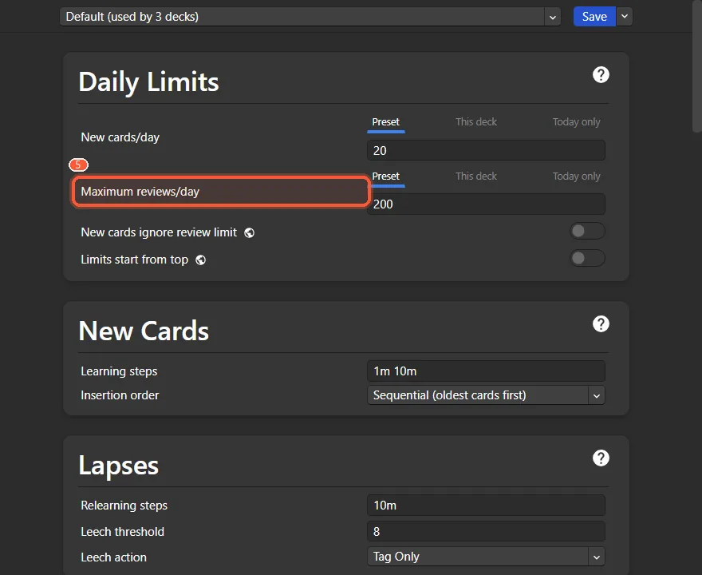

Credit to [Danika_Dakika](https://forums.ankiweb.net/u/danika_dakika) for sharing this nested backlog workflow in [Addressing Backlog](https://forums.ankiweb.net/t/adressing-backlog/43842) on the Anki Forums. This approach pairs with the official [Catching Up](../manual/filtered-decks#catching-up) guide so you can keep reviewing current cards while folding overdue reviews back in at a controlled daily pace.

## Overview of the Workflow

1. Pause **New** cards by setting **New cards/day** to `0` on your main deck so unlearned cards stop adding to the pile.
2. Create an empty wrapper deck (for example `Demo deck::Catchup`) and nest a Filtered Deck inside it (`Demo deck::Catchup::Overdue`) using an overdue search filter such as `deck:"Demo deck" is:due prop:due<=-1`. If you study multiple separate subjects, create one catchup filtered deck per subject.
3. Choose **Descending Retrievability** as the sort order for the Filtered Deck so Anki serves the overdue cards you can recover most efficiently first, raise the card limit high enough to include the overdue pool, and leave rescheduling turned on.
4. Set your daily backlog quota on the **empty wrapper deck** instead of rebuilding the Filtered Deck every day. In **Deck Options** for that wrapper deck, switch **Maximum reviews/day** under **This deck** to your preferred daily allowance. Collapse the wrapper deck if you prefer to hide the large overdue count, and raise **Today only** whenever you have extra time for more backlog cards.
5. Study from your main deck as normal each day, finishing all current due Review cards together with today's catchup allowance and graduating all Learn and Relearn cards back into Review. Once the backlog clears, restore a sustainable **New cards/day** limit.

<!-- tutorial:addressing-backlog:start -->

> [!mimik] Setting Up a Nested Backlog Catchup Deck
> Pause new cards, isolate overdue reviews with Descending Retrievability, and cap your daily backlog pace from an empty parent deck.
>
> ---
>
> ## Step 01: Set New Cards/Day to Zero
>
> 
>
> Open **Options** for **Demo deck**, go to **Daily Limits**, and set **New cards/day** to `0` until your overdue backlog clears.
>
> ---
>
> ## Step 02: Create an Empty Wrapper Subdeck
>
> 
>
> Click **Create Deck** at the bottom of the Decks screen and name an empty wrapper deck such as `Demo deck::Catchup` so you can collapse the backlog count and study from **Demo deck** in one click.
>
> ---
>
> ## Step 03: Gather Overdue Cards in a Nested Filtered Deck
>
> 
>
> Open **Tools > Create Filtered Deck...**, name it `Demo deck::Catchup::Overdue` so it nests inside your wrapper deck, enter `deck:"Demo deck" is:due prop:due<=-1`, raise the **Limit**, and keep rescheduling enabled.
>
> ---
>
> ## Step 04: Select Descending Retrievability Order
>
> 
>
> Change **cards selected by** to **Descending Retrievability** so Anki tackles easier overdue cards first while working down your backlog, then click **Build**.
>
> ---
>
> ## Step 05: Cap Your Daily Allowance on the Wrapper Deck
>
> 
>
> Open **Options** on the empty wrapper deck (`Demo deck::Catchup`), switch to **This deck**, and set **Maximum reviews/day** to your daily backlog quota. On days you want extra backlog cards, raise **Today only** instead of rebuilding the Filtered Deck.

<!-- tutorial:addressing-backlog:end -->
