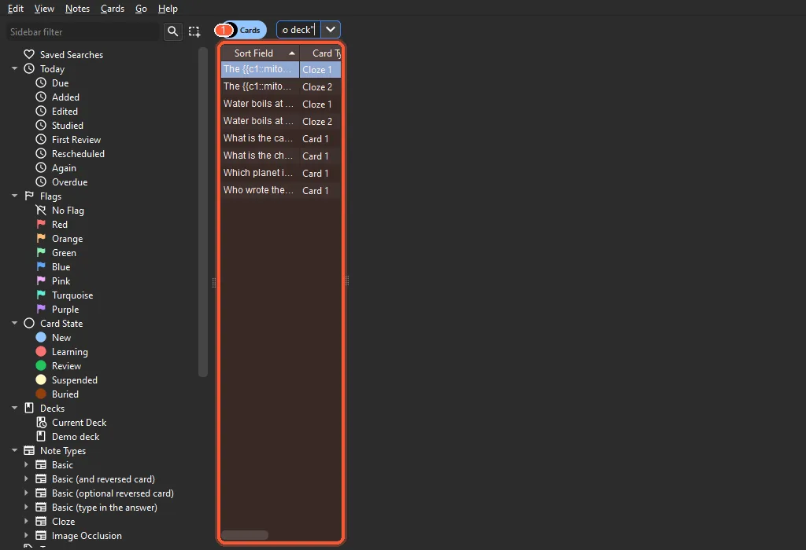
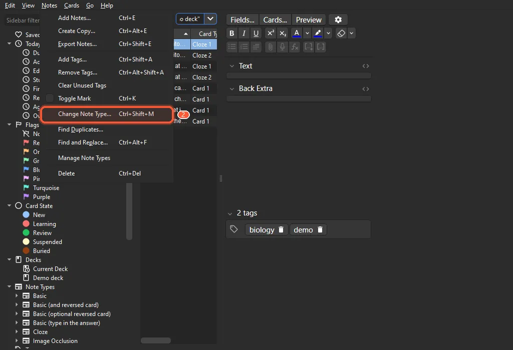

Convert existing notes from one note type to another (for example, **Basic** to **Basic (and reversed card)**) and map their fields without re-entering data. For full details, see the [official Anki Manual](https://docs.ankiweb.net/).

## Conversion Workflow

<!-- tutorial:changing-note-types:start -->

> [!mimik] Changing Note Types on Existing Cards
> Convert existing notes to another note type in the Card Browser and map their fields.
>
> ---
>
> ## Step 01: Select Notes in the Browser
>
> 
>
> Open **Browse** (`B`), filter to the deck or notes you want to convert, and select one or more rows.
>
> ---
>
> ## Step 02: Open Notes > Change Note Type...
>
> 
>
> Click **Notes > Change Note Type...** (or press `Ctrl+Shift+M`), pick the target note type, map each existing field to its destination field, and click **Save**.

<!-- tutorial:changing-note-types:end -->
