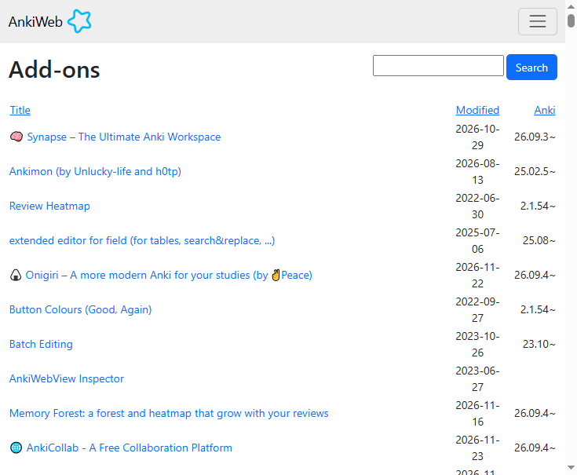
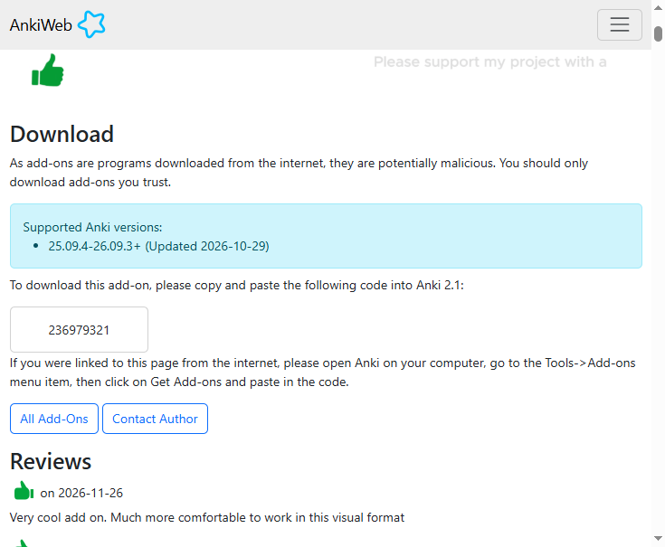

Find, download, and install community add-ons using their AnkiWeb code. For full details on managing add-ons, see the [official Anki Manual](https://docs.ankiweb.net/addons.html) and our [Managing Add-ons](../manual/addons.md) walkthrough.

## Add-on Installation Workflow

## 1. Find an Add-on & Copy Its Code on AnkiWeb

Visit [ankiweb.net/shared/addons](https://ankiweb.net/shared/addons) to browse by **Title**, **Modified**, or **Anki** version, or search in the top-right bar.

Open the add-on's page, scroll to **Download**, check **Supported Anki versions**, and copy the numeric code box (you can also use **All Add-Ons** or **Contact Author** below it).

## 2. Install in Anki

1. Open **Tools > Add-ons** (`Ctrl+Shift+A`).
2. Click **Get Add-ons...**, paste the numeric code, and click **OK**.
3. Restart Anki for the add-on to take effect.
