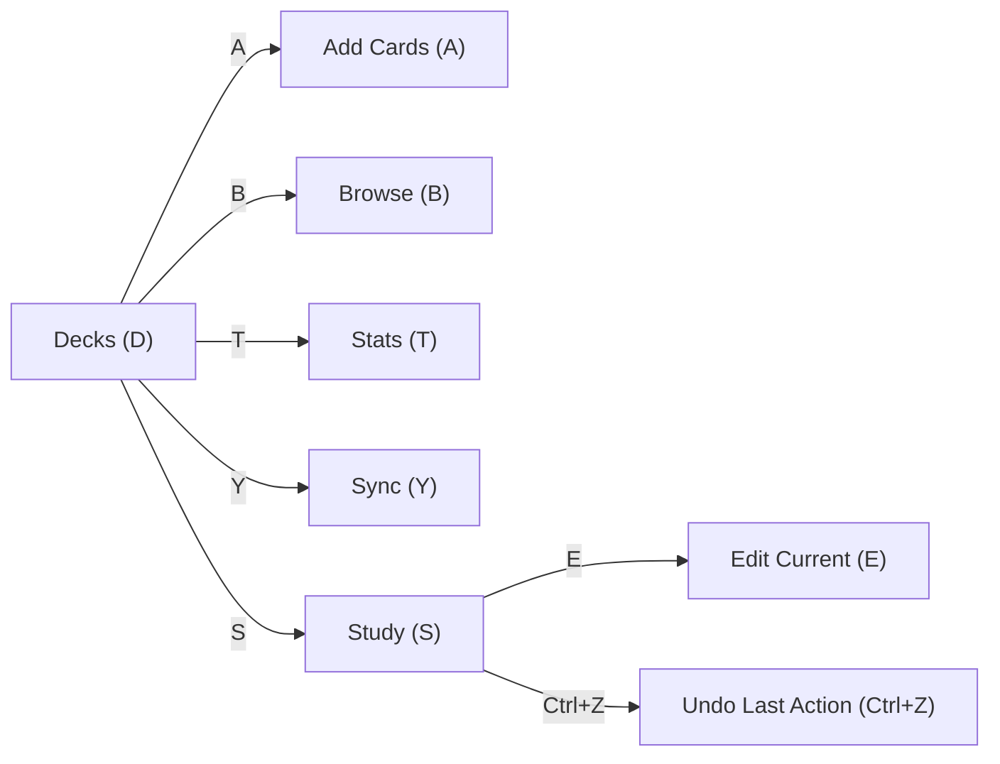
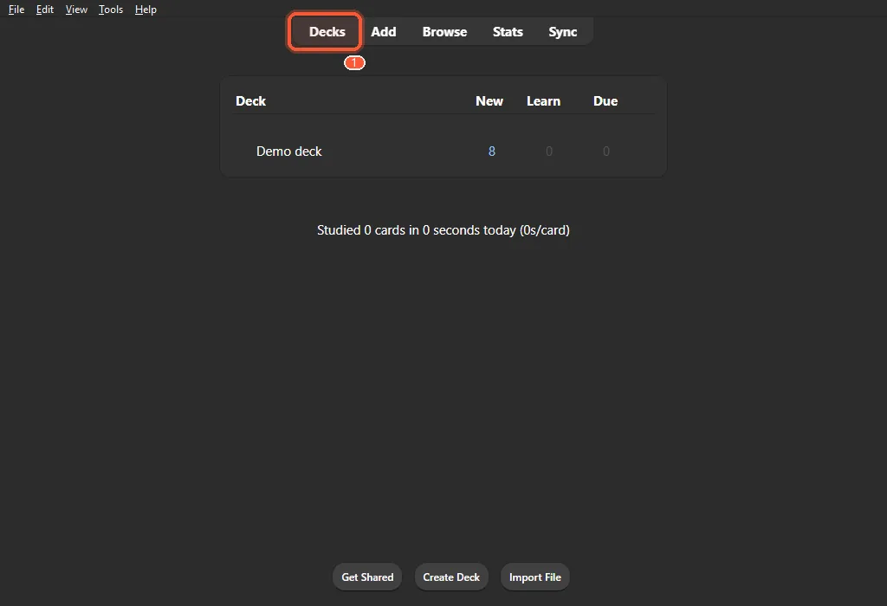
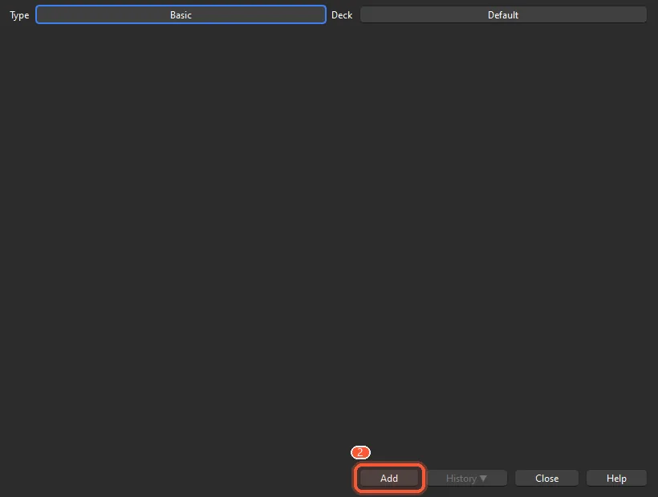
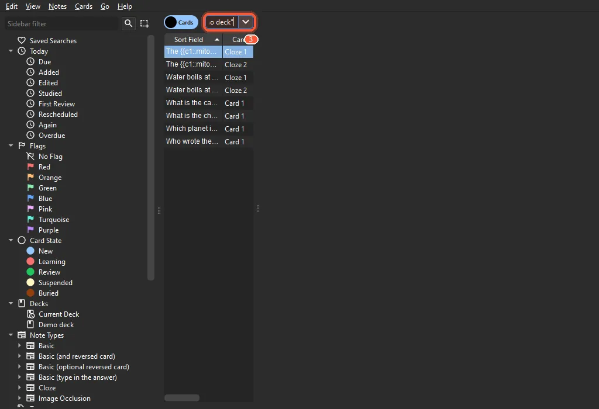
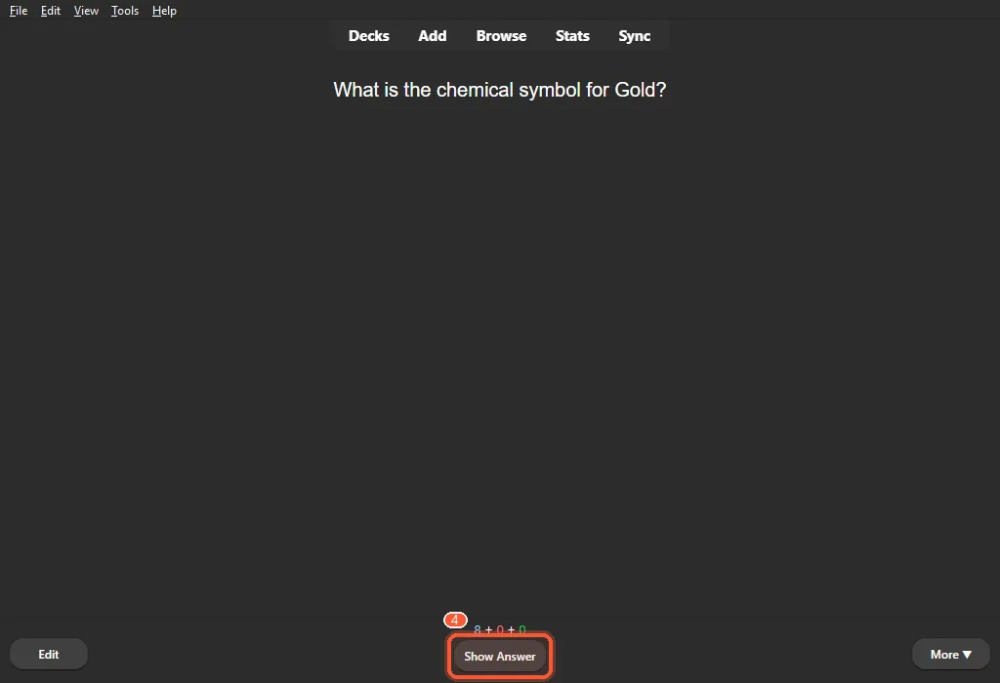
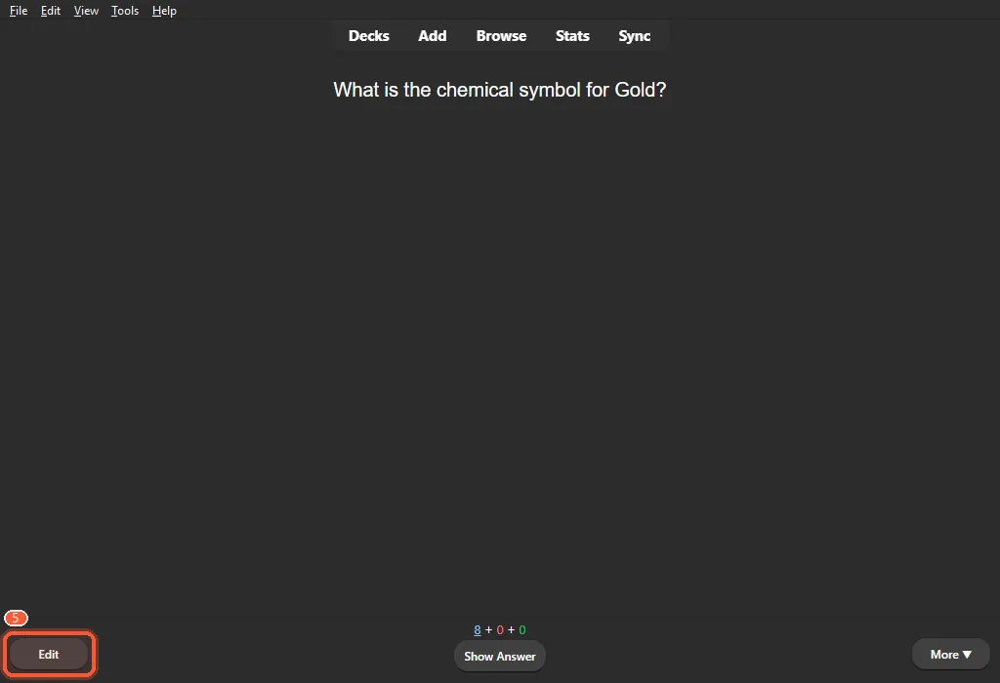

Move between Anki's main screens and dialogs without reaching for the mouse. For the full reference, see the [official Anki Manual](https://docs.ankiweb.net/).

## Screen-to-Screen Shortcut Map

## Core Navigation Shortcuts

| Shortcut | Action |
| :--- | :--- |
| `D` | Return to the **Decks** screen |
| `A` | Open the **Add** window |
| `B` | Open the **Browse** window |
| `T` | Open **Stats** |
| `Y` | Trigger **Sync** |
| `S` | Start **Study** on the selected deck |
| `E` | **Edit** the current card while studying |
| `Ctrl+Z` | **Undo** the last action |

<!-- tutorial:keyboard-shortcuts-tour:start -->

> [!mimik] Navigating Anki with Keyboard Shortcuts
> Jump between Decks, Add, Browse, Study, and Edit using single-key shortcuts.
>
> ---
>
> ## Step 01: Decks & Top Toolbar (D, A, B, T, Y)
>
> 
>
> From anywhere in the main window, press `D` for **Decks**, `A` for **Add**, `B` for **Browse**, `T` for **Stats**, or `Y` to **Sync**.
>
> ---
>
> ## Step 02: Open the Add Window (A)
>
> 
>
> Press `A` to open **Add** from the main window. Fill in your fields and click **Add** (or press `Ctrl+Enter`).
>
> ---
>
> ## Step 03: Open the Card Browser (B)
>
> 
>
> Press `B` to open **Browse** and search, filter, or organize cards across your decks.
>
> ---
>
> ## Step 04: Start Studying (S)
>
> 
>
> Press `S` from the Decks or Overview screen to start **Study**, then press `Space` to show the answer.
>
> ---
>
> ## Step 05: Edit the Current Card (E)
>
> 
>
> While studying, press `E` (or click **Edit**) to open the current card's fields, or press `Ctrl+Z` to undo your last action.

<!-- tutorial:keyboard-shortcuts-tour:end -->
