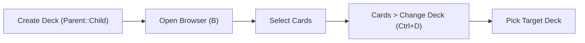
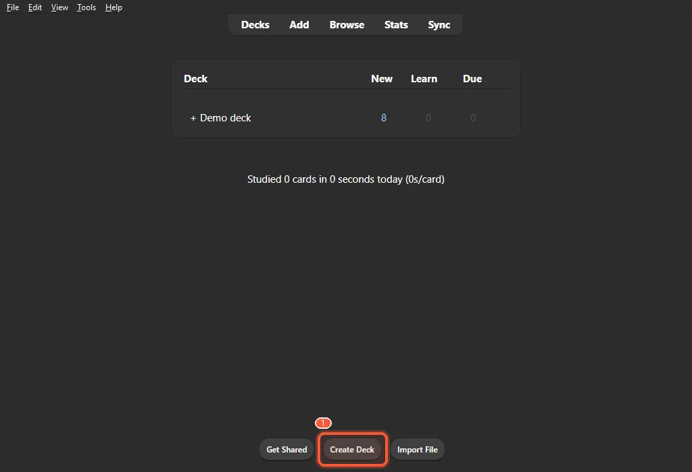
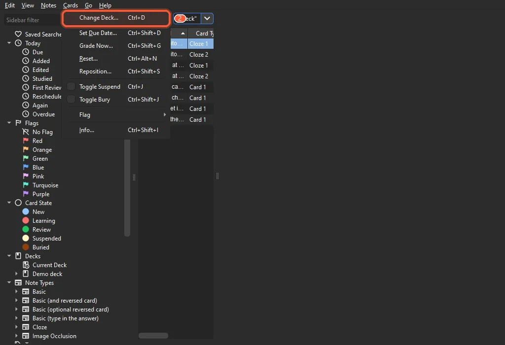
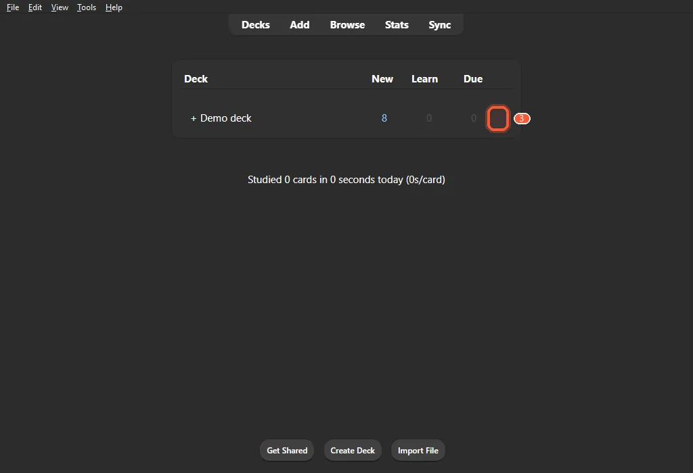

Use nested deck names (`Parent::Child`) and the Card Browser's **Change Deck** action to organize decks and move cards without losing scheduling history.

<!-- tutorial:moving-and-renaming-decks:start -->

> [!mimik] Creating Subdecks & Moving Cards
> Create a nested subdeck with `::` notation, move cards in the Browser, and rename decks from the gear menu.
>
> ---
>
> ## Step 01: Create a Nested Subdeck
>
> 
>
> Click **Create Deck** at the bottom of the Decks screen and enter a `Parent::Child` name such as `Demo deck::Subdeck` to nest it inside **Demo deck**.
>
> ---
>
> ## Step 02: Move Selected Cards via Cards > Change Deck
>
> 
>
> Open the **Browser** (<kbd>B</kbd>), select the cards you want to move, and choose **Cards > Change Deck...** (<kbd>Ctrl</kbd>+<kbd>D</kbd>).
>
> ---
>
> ## Step 03: Rename or Manage a Deck from the Gear Menu
>
> 
>
> Click the gear icon next to any deck to **Rename** it (you can also add or remove `::` nesting here) or **Delete** an empty deck.

<!-- tutorial:moving-and-renaming-decks:end -->
