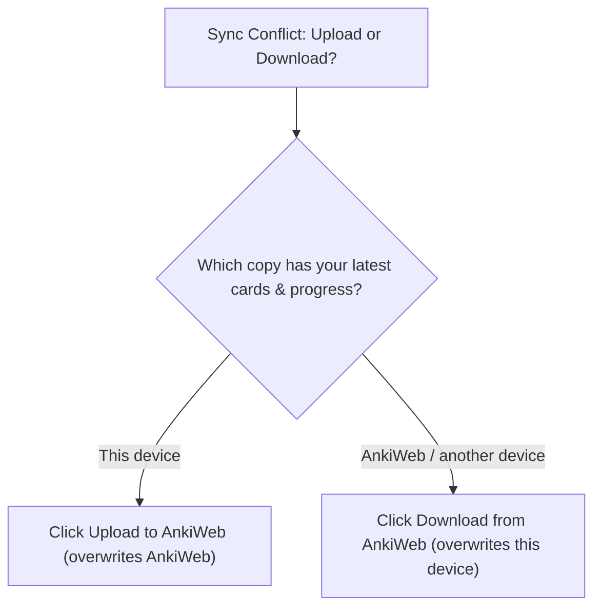
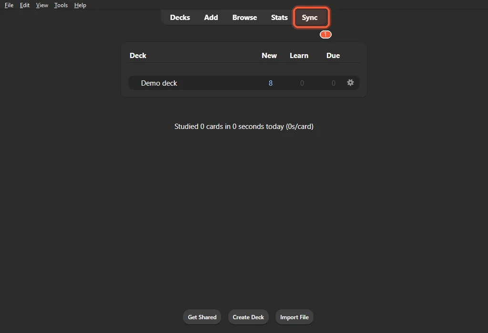
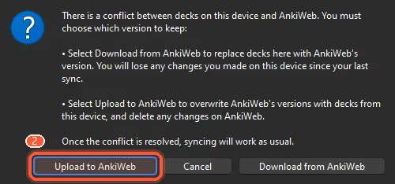
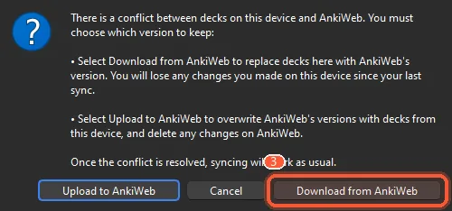

Connect Anki to your AnkiWeb account and choose the right option when a full-sync conflict dialog appears. For full details, see the [official Anki Manual](https://docs.ankiweb.net/syncing.html).

## Upload vs Download Decision Map

<!-- tutorial:syncing-ankiweb:start -->

> [!mimik] Syncing Across Devices: Upload vs Download
> Trigger a sync and choose the right option when a full-sync conflict dialog appears.
>
> ---
>
> ## Step 01: Click Sync (or Press Y)
>
> 
>
> Click **Sync** in the top toolbar (or press `Y`) to sync your collection with AnkiWeb.
>
> ---
>
> ## Step 02: Choose Upload to AnkiWeb (Keep This Device)
>
> 
>
> Click **Upload to AnkiWeb** when **this device** has your latest cards and review history. This overwrites AnkiWeb with your local collection.
>
> ---
>
> ## Step 03: Choose Download from AnkiWeb (Keep Server Copy)
>
> 
>
> Click **Download from AnkiWeb** when **another device / AnkiWeb** has your latest changes. This replaces your local decks with AnkiWeb's copy.

<!-- tutorial:syncing-ankiweb:end -->
