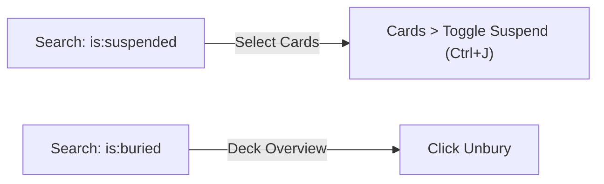
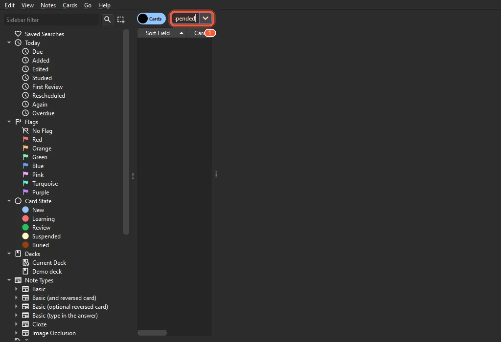
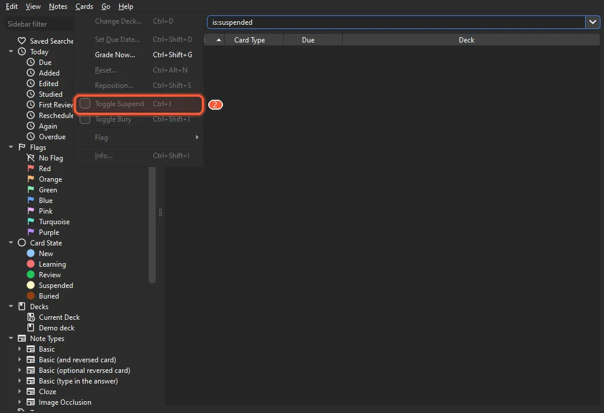

Find hidden cards in the Card Browser and bring them back into your study queue. For full details on card states, see the [official Anki Manual](https://docs.ankiweb.net/).

## Filter-to-Action Map

<!-- tutorial:unsuspending-cards:start -->

> [!mimik] Unsuspending & Unburying Cards
> Locate suspended or buried cards in the Browser and restore them to your study queue.
>
> ---
>
> ## Step 01: Filter by is:suspended in the Browser
>
> 
>
> Open **Browse** (`B`) and type `is:suspended` (or `is:buried`) in the search bar to list hidden cards.
>
> ---
>
> ## Step 02: Toggle Suspend from the Cards Menu
>
> 
>
> Select the cards and click **Cards > Toggle Suspend** (or press `Ctrl+J`). For buried cards, you can also click **Unbury** on the Deck Overview screen.

<!-- tutorial:unsuspending-cards:end -->
