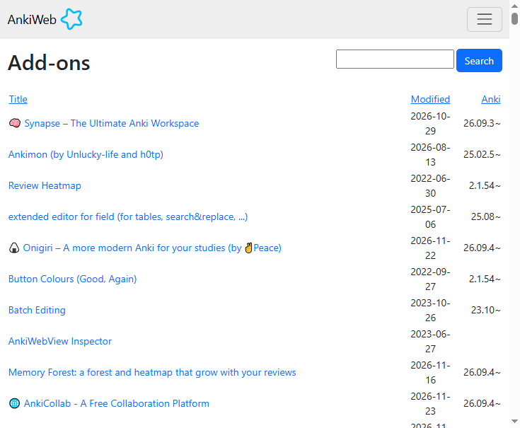
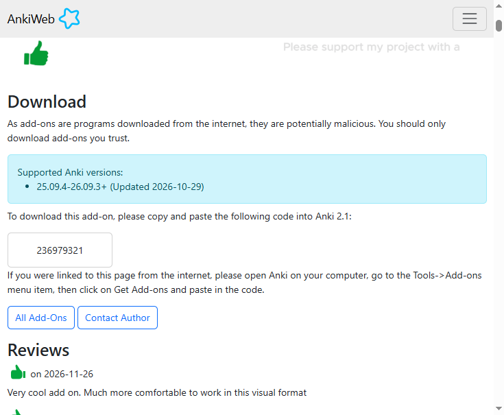
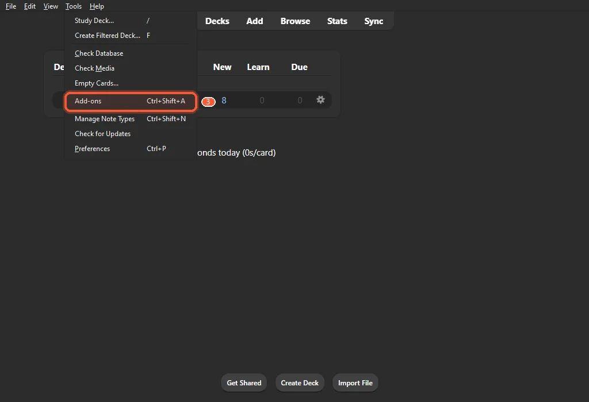
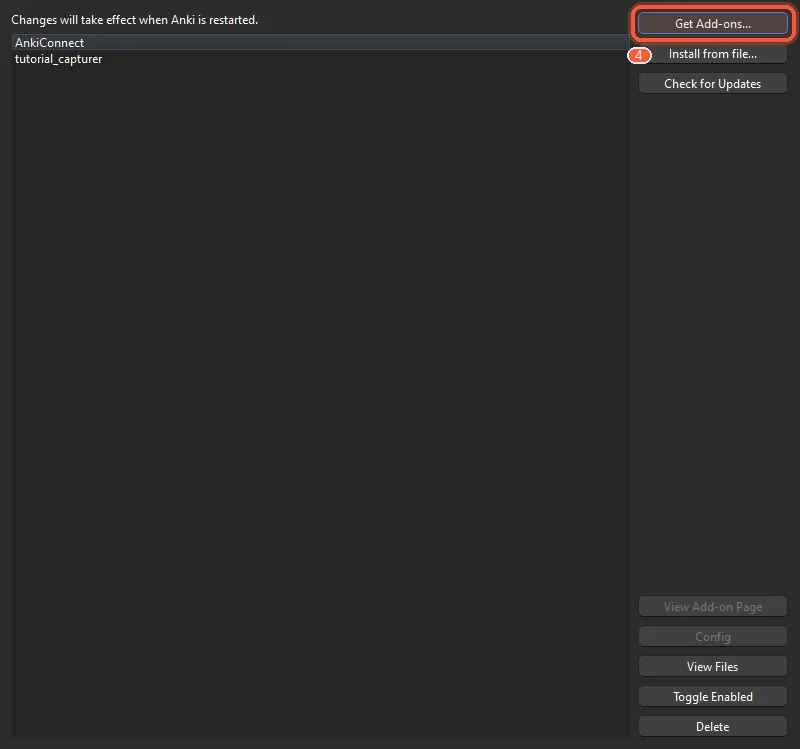

Anki's capabilities can be extended with add-ons. Add-ons can provide
features like extra support for specific languages, extra control over
scheduling, and so on.

To browse the list of available add-ons, select **Tools &gt; Add-ons**, then click on **Get Add-ons**.
Alternatively, open [ankiweb.net/shared/addons](https://ankiweb.net/shared/addons) in a web browser.

If you have downloaded an add-on that is not working properly, or if you
accidentally made a mistake when editing an add-on, you can use the
**Delete** option in the menu to remove it.

Add-ons use and modify arbitrary parts of Anki’s codebase, so in some
cases, updating Anki can break the compatibility with older add-ons. If
one of your add-ons stops working after updating Anki, please consider
reporting the issue to the add-on author. If you rely on this add-on,
you will need to keep using an older Anki version until the add-on gets
an update.

There is a **Contact Author** button on most add-ons pages on AnkiWeb,
and many authors include their email address in the add-on, so if you
need to get in touch with the author, editing the add-on and looking at
the top of the file may help.

To learn how to write your own add-ons, see the [add-on writing guide](https://docs.ankiweb.net/addons/intro).

<!-- tutorial:manage-addons:start -->

> [!mimik] Finding & Managing Add-ons
> Find an add-on code on AnkiWeb, install it in Anki via Tools > Add-ons, and manage or configure installed add-ons.
>
> ---
>
> ## Step 01: Browse or Search AnkiWeb Add-ons
>
> 
>
> Visit [ankiweb.net/shared/addons](https://ankiweb.net/shared/addons) to browse add-ons sorted by **Title**, **Modified** date, or **Anki** version, or use the top-right **Search** bar.
>
> ---
>
> ## Step 02: Copy the Add-on Code from the Download Section
>
> 
>
> Open the add-on's page, scroll to **Download**, verify **Supported Anki versions**, and copy the numeric code box (you can also use **All Add-Ons** or **Contact Author** below it).
>
> ---
>
> ## Step 03: Open Tools > Add-ons
>
> 
>
> From Anki's main menu bar, choose **Tools > Add-ons** (or press <kbd>Ctrl</kbd>+<kbd>Shift</kbd>+<kbd>A</kbd>).
>
> ---
>
> ## Step 04: Install or Configure Add-ons
>
> 
>
> Click **Get Add-ons...** and paste the code from Step 2, or select an installed add-on to use **Config**, **View Files**, **Toggle Enabled**, or **Delete**.

<!-- tutorial:manage-addons:end -->
