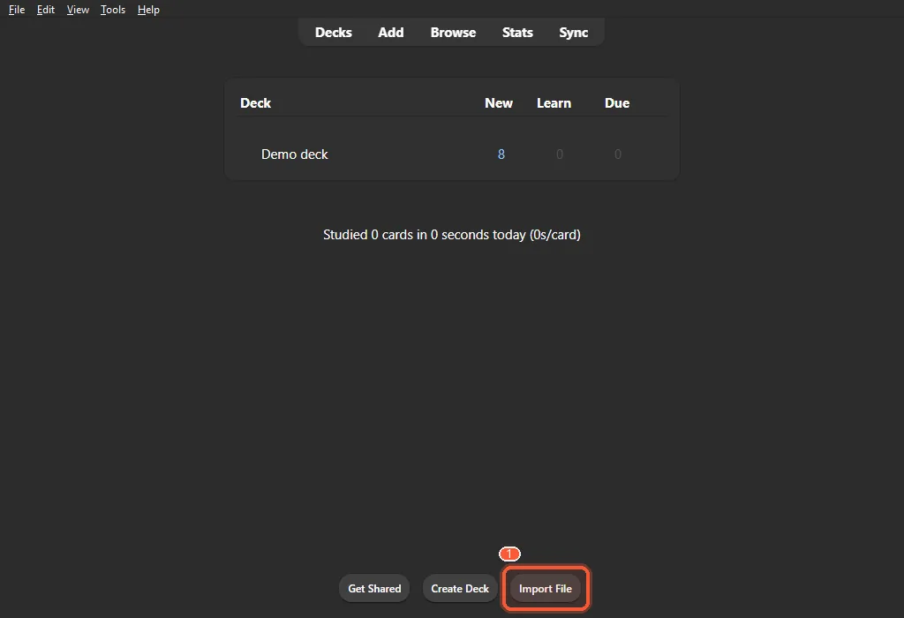
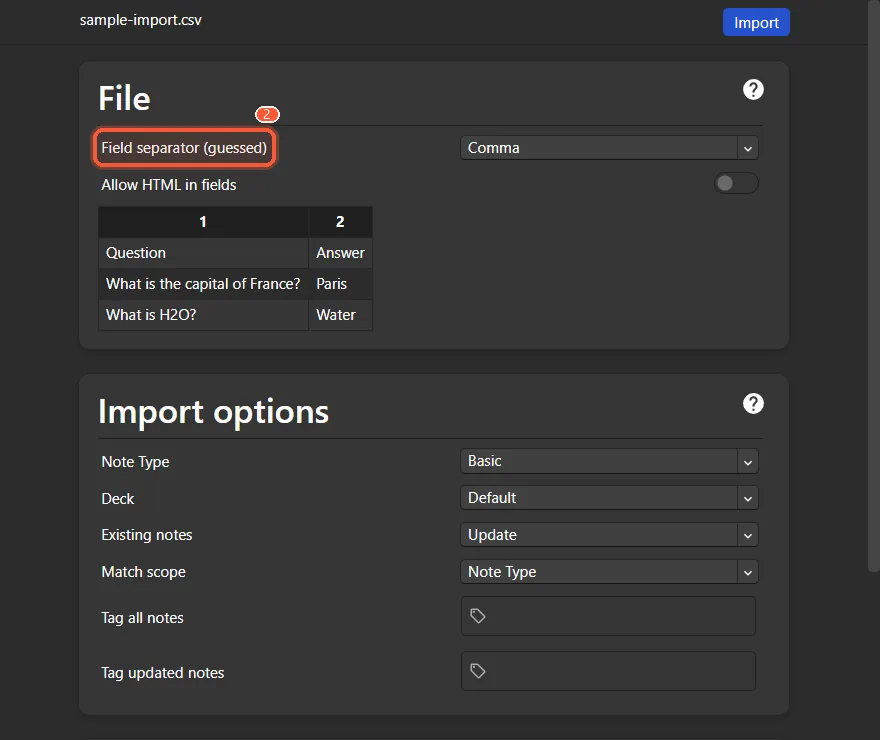
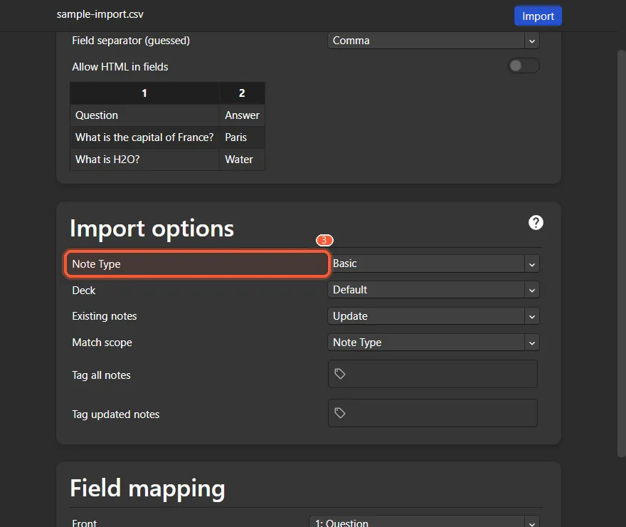
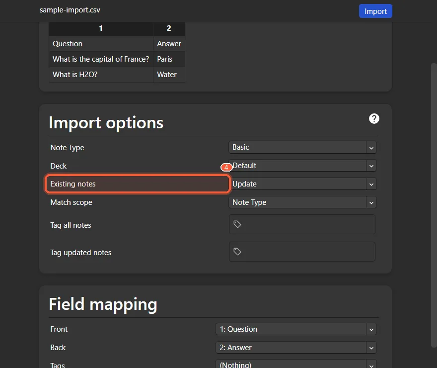
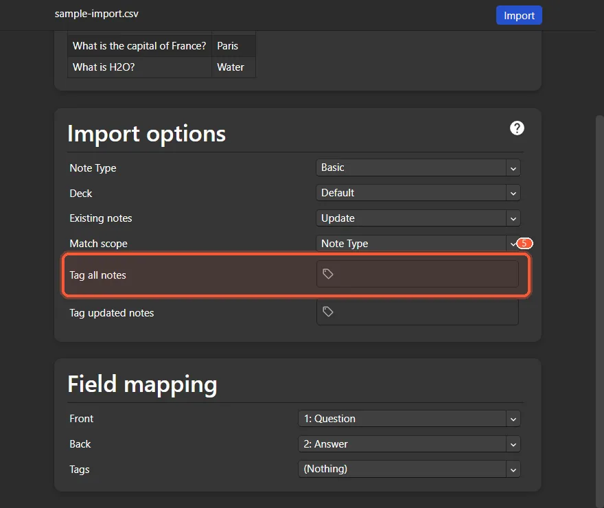
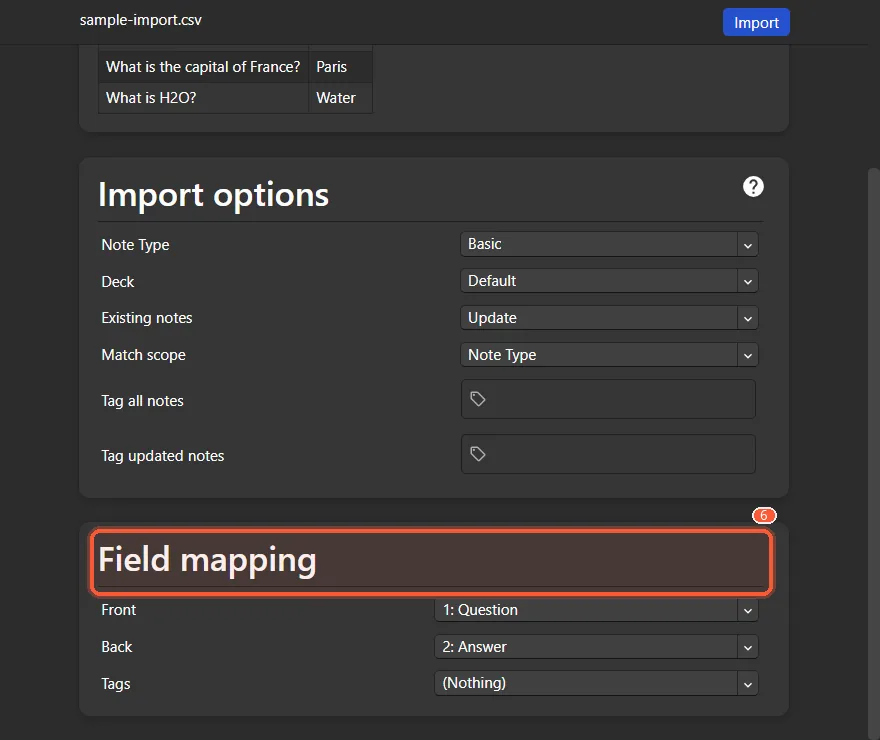
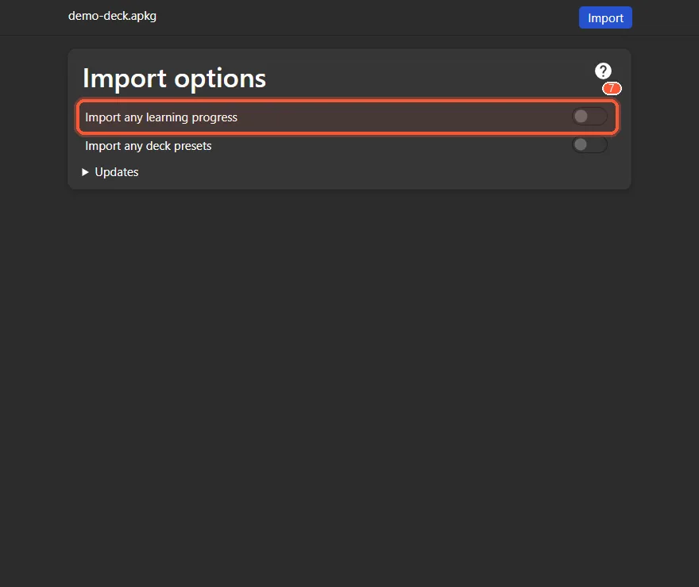
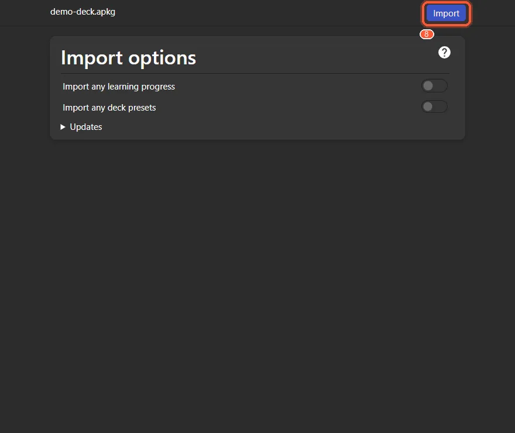

Anki can import text files, packaged Anki decks created by the export
feature and Mnemosyne 2.0 .db files. To import a
file, click the File menu and then "Import".

<!-- tutorial:import-files:start -->

> [!mimik] Importing Decks and Text Files
> Configure separators, duplicate matching, tags, field mapping, and packaged deck options on the built-in Import screen.
>
> ---
>
> ## Step 01: Click Import File on the Decks Screen
>
> 
>
> Click **Import File** at the bottom of the Decks screen (or choose **File > Import...** / <kbd>Ctrl</kbd>+<kbd>Shift</kbd>+<kbd>I</kbd>).
>
> ---
>
> ## Step 02: Verify the Field Separator and HTML Option
>
> 
>
> When importing a `.csv`, `.tsv`, or `.txt` file, check **Field separator** (`Comma`, `Semicolon`, `Tab`, `Space`, `Colon`, or `Pipe`), toggle **Allow HTML in fields** if your file contains HTML tags or ` `, and confirm the preview table separates columns cleanly.
>
> ---
>
> ## Step 03: Pick the Target Note Type and Deck
>
> 
>
> Under **Import options**, choose which **Note Type** (such as `Basic` or `Cloze`) and destination **Deck** (`Demo deck`) the imported notes should use.
>
> ---
>
> ## Step 04: Set Existing Notes and Match Scope
>
> 
>
> Choose how Anki handles notes whose first field matches existing notes (**Existing notes**: `Update`, `Preserve`, or `Duplicate`), and set **Match scope** to check duplicates across the entire **Note Type** or only **Notetype and Deck**.
>
> ---
>
> ## Step 05: Add Optional Tags on Import
>
> 
>
> Enter tags in **Tag all notes** to label every imported note, or **Tag updated notes** to mark only notes that overwrote existing cards.
>
> ---
>
> ## Step 06: Map File Columns to Note Fields
>
> 
>
> Scroll down to **Field mapping** to match each column in your file (`1`, `2`, etc.) to a note field (such as `Front`, `Back`, `Tags`, or `(Nothing)` to skip a column).
>
> ---
>
> ## Step 07: Review Packaged Deck (.apkg) Import Options
>
> 
>
> When opening an `.apkg` deck package, choose whether to **Import any learning progress**, **Import any deck presets**, and expand **Updates** to control **Update notes** and **Update note types** (`If newer`, `Always`, or `Never`) plus **Merge note types**.
>
> ---
>
> ## Step 08: Click Import to Finish
>
> 
>
> Once your file or package options look right, click **Import** in the top-right corner to add the notes and cards to your collection.

<!-- tutorial:import-files:end -->
